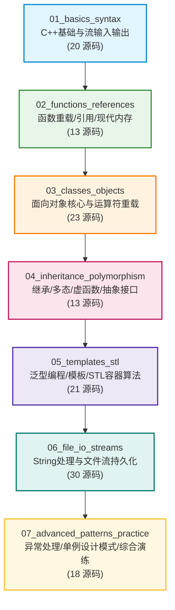

# C++ 核心编程进阶学习路线图 (STUDY_ROADMAP.md)

> 本知识库源码选自国际知名计算机教育频道 **Portfolio Courses**（Kevin Browne 教授），全库共 **138 个 C++ 源码文件**。
>
> 依照从 **C 面向过程向 C++ 现代面向对象与泛型思维跨越** 的学习规律，全库已被严格划分为 **7 个英文主题阶段**。每个阶段内部的文件名均冠以建议学习顺序的两位数序号（`01_...` ~ `30_...`），所有源码均添加了精炼的中文导读题注，修复了潜在缺陷，并通过了 `g++ -std=c++17 -Wall -Wextra` 的 100% 编译检验。

---

## ⚖️ 本套 C++ 教学代码的优缺点客观评价

| 维度 | 评价要点 | 给学习者的具体建议 |
| :--- | :--- | :--- |
| **核心优点** ⭐ | 1. **概念纯粹、最小可行示例（Minimal Reproducible Examples）**：每个文件代码量大多在 50~150 行之间，绝不掺杂繁杂业务，单点打透 1~2 个语法特性，认知负担极低。<br/>2. **核心机制剖析透彻**：不仅教语法，更深入底层剖析（例如专门演示**虚析构函数防止内存泄漏**、**深浅拷贝的指针悬垂风险**、**委托构造与初始化列表的效率**）。 | 非常适合作为大一、大二学生从 C 语言面向过程平滑过渡到 C++ 面向对象、泛型编程的**第一套系统化练习库**。 |
| **明显短板** ⚠️ | 1. **代码偏向传统 C++（C++98/03 痕迹重）**：内存管理大量使用裸指针与 `new`/`delete`，缺少现代 C++（C++11/14/17/20）工程必备的**智能指针（Smart Pointers）**。<br/>2. **单线程且缺少并发**：未涉及 `<thread>`、`<mutex>`、`<atomic>`，而现代机器人系统是高度依赖多线程的实时系统。<br/>3. **未覆盖闭包与移动语义**：缺少 Lambda 表达式与右值引用 `std::move`。 | **把它当作面向对象基本功的“打桩阶段”**。学完后必须按照本路线图文末的【特种补强指南】定向补充现代 C++ 特性与机器人实战库。 |

---

## 🤖 机器人工程专业核心转折点：C 语言学到什么程度可以/应当过渡到 C++？

> **核心结论**：**千万不要等把全部 C 语言细枝末节刷完才开始学 C++！**
> 当你掌握了 C 语言的 **基础控制流 + 二维数组/矩阵 + 指针与堆栈内存 + 结构体与内存对齐 + 底层位运算** 后，你就已经具备了进入 C++ 的 **100% 充要条件**，应当**立即启动 C++ 学习**！

### 1. 为什么机器人专业要尽早迈入 C++？
在现代机器人工程技术栈中，**C++ 是绝对的核心中枢，占据了 90% 以上的主战场**：
- **核心框架全栈 C++**：机器人操作系统（**ROS2**）、导航决策系统（**Nav2**）、机械臂运动规划（**MoveIt**）、计算机视觉库（**OpenCV**）、激光与视觉 SLAM 建图算法、自动驾驶 Planning & Control，**底层架构全部是用现代 C++ 编写的**。
- **纯 C 语言的使用边界**：仅局限在**下位机单片机（STM32 / ESP32）的极低层裸机固件或 FreeRTOS 驱动**中。
- **时间成本警示**：如果在 C 语言阶段耗费数月死磕纯 C 动态链表、纯 C 复杂文本解析或怪异的预处理器宏技巧，属于在早已被现代工业废弃的低效工具上浪费宝贵的大学精力。

### 2. 过渡前必须掌握的 C 语言核心（绿灯放行清单 ✅）
在开始学 C++ 之前，只要确认自己掌握了以下 5 项即可果断转入 C++：
1. **控制流与函数传参**：分支、循环、函数声明/定义、形参值传递（明白会发生数据复制）。
2. **计算机内存区域划分**：明白**栈区（Stack，局部变量自动消亡）**与**堆区（Heap，`malloc`/`free` 手动申请与释放）**的区别。
3. **指针与物理地址认知**：
   - 取地址符 `&` 是拿门牌号，解引用 `*` 是进屋取值；
   - 指针作形参可改变外部实参；指针遍历数组步长原理；
   - 函数指针（Function Pointer）初步（理解函数入口本质也是内存地址，用于中断或事件回调）。
4. **结构体与字节对齐（Memory Padding）**：
   - 会用 `struct` 封装传感器数据，掌握 `->` 运算符；
   - 搞懂内存对齐：为什么 1 个 `char` 加 1 个 `int` 的结构体占用 8 字节而不是 5 字节（对 CAN/串口通信封包至关重要）。
5. **底层位运算（Bitwise）**：
   - 熟练运用 `&`、`|`、`^`、`~`、`<<`、`>>`，用于配置单片机寄存器和解析硬件状态掩码。

### 3. 可以果断跳过、移步至 C++ 中学习的领域（红黄灯绕行清单 🛑）
- ❌ **繁琐手写动态单双链表、二叉树**：C 语言手写指针链表极易发生野指针与内存泄漏；C++ 的 STL 容器 `std::vector`、`std::list`、`std::map` 是工业级实现，安全高效。
- ❌ **纯 C 字符串复杂拼接与切分（`strcat`, `strtok`）**：C 的 `char*` 是内存越界的重灾区；C++ 的 `std::string` 自带安全边界管理与自动扩容。
- ❌ **复杂古怪的预处理器宏黑魔法**：现代 C++ 用泛型模板（`template`）和编译期常量（`constexpr`）替代了 99% 的复杂宏，具备严格的类型安全。

---

## 🗺️ 全景阶段导引



---

## 阶段一：C++ 基础语法与流式输入输出 (01_basics_syntax)
> **学习目标**：掌握 `std::cin` / `std::cout` 流操作符、原生 `bool`、区间循环（Range-based for）与 C++ 基本逻辑结构。

| 序号 | 源码文件 | 核心技术要点 | 建议关注 |
| :---: | :--- | :--- | :--- |
| **01** | `01_hello_world.cpp` | C++ 极简入口、命名空间 `std` 简述 | 流输出 `cout << endl` |
| **02** | `02_comments.cpp` | 单行注释 `//` 与多行块注释规范 | 块注释不可嵌套避坑 |
| **03** | `03_cout.cpp` | 流式链式输出、格式换行 | 替代 C 的 `printf` |
| **04** | `04_cin.cpp` | 流式标准输入提取符 `>>` | 替代 C 的 `scanf`（类型安全） |
| **05** | `05_add_two_numbers.cpp` | 变量定义、交互式两数求和 | 交互式数据流读写 |
| **06** | `06_check_number_sign.cpp` | `if - else if - else` 条件分支 | 判断正负数与零 |
| **07** | `07_even_or_odd.cpp` | 取模运算符 `%` 与奇偶判断 | 分支条件求值 |
| **08** | `08_if_statements.cpp` | 条件判断语句详解、复合布尔表达式 | 逻辑与 `&&`、或 `\|\|`、非 `!` |
| **09** | `09_ternary_operator.cpp` | 三元条件运算符 `? :` 基础表达式 | 简洁条件赋值 |
| **10** | `10_ternaryop_lvalue.cpp` | **C++ 特性**：三元运算符可作左值赋值 | `(a > b ? a : b) = 100;` |
| **11** | `11_switch_statements.cpp` | `switch-case` 多分支选择结构 | 穿透（fall-through）机制与 `break` |
| **12** | `12_switch_menu.cpp` | 基于 switch 的命令行控制台交互菜单 | 真实菜单逻辑结构 |
| **13** | `13_while_loops.cpp` | `while` 当型循环与循环不变式 | 计数器控制循环 |
| **14** | `14_do_while_loop.cpp` | `do-while` 直到型循环（至少执行一次） | 适合用户输入校验 |
| **15** | `15_for_loop.cpp` | 标准 `for` 计数循环 | 初始化、循环条件、递增语句 |
| **16** | `16_range_based_for_loop.cpp` | **现代 C++ 核心**：基于范围的 `for (auto x : container)` | 遍历原生数组与 STL 容器 |
| **17** | `17_input_validation_do_while.cpp` | 输入健壮性验证循环 | 边界值过滤防御 |
| **18** | `18_gcd.cpp` | 经典欧几里得算法求最大公约数 | 循环迭代与辗转相除 |
| **19** | `19_cmdargs.cpp` | 命令行参数 `argc` 与 `argv[]` 处理 | 外部启动传参解析 |
| **20** | `20_coin_flip.cpp` | 随机数生成与模拟抛硬币 | `<cstdlib>` 随机发生器 |

---

## 阶段二：函数进阶、引用语义与现代内存 (02_functions_references)
> **学习目标**：掌握 C++ 最核心的**引用传递（Reference）**、函数重载、默认参数以及 `new` / `delete` 堆内存管理。

| 序号 | 源码文件 | 核心技术要点 | 对比 C 语言的重要飞跃 |
| :---: | :--- | :--- | :--- |
| **01** | `01_functions.cpp` | 函数声明、原型、定义与参数值传递 | 模块化封装基石 |
| **02** | `02_function_overloading.cpp` | **函数重载（Overloading）**：同名不同参 | 告别 C 中繁琐的命名区隔 |
| **03** | `03_default_arguments.cpp` | **函数默认形参**：缺省参数语法 | 增强函数调用的灵活性 |
| **04** | `04_reference_variables.cpp` | **引用变量（Reference）**：变量的绝对别名 | 没有空引用、无解引用开销 |
| **05** | `05_pass_by_reference.cpp` | **引用传递**：形参修改直接作用于实参 | 极大优于指针传递的简洁语法 |
| **06** | `06_const_array_parameters.cpp` | `const` 数组参数保护（只读约束） | 增强工程接口防御性设计 |
| **07** | `07_return_multiple_values.cpp` | 利用引用传参实现多值返回 | 替代 C 中双重指针传出参数 |
| **08** | `08_new_delete.cpp` | 动态内存分配：`new`、`new[]`、`delete`、`delete[]` | 替代 `malloc`/`free`（自动调用构造/析构） |
| **09** | `09_count_integer_digits.cpp` | 循环统计整数位数 | 算法复杂度分析 |
| **10** | `10_count_integer_digits_recursion.cpp` | 递归法统计整数位数 | 递归基准条件与调用栈机制 |
| **11** | `11_sum_number_digits_recursive.cpp` | 递归求整数各个数位之和 | 递归解构数值问题 |
| **12** | `12_fibonacci.cpp` | 斐波那契数列（递归与迭代对比） | 递归边界条件设计 |
| **13** | `13_dice_roll.cpp` | 掷骰子概率随机模拟 | 随机种子与均匀分布 |

---

## 阶段三：面向对象核心机制与运算符重载 (03_classes_objects)
> **学习目标**：全面理解类与对象、封装性（访问控制）、构造/析构函数、初始化列表、`this` 机制、静态成员与运算符重载。

| 序号 | 源码文件 | 核心技术要点 | 关键工程意义 |
| :---: | :--- | :--- | :--- |
| **01** | `01_oo_intro.cpp` | 面向对象编程思想入门、类声明与对象实例化 | 从过程化向结构化对象演进 |
| **02** | `02_public_vs_private.cpp` | `public` 与 `private` 访问权限控制 | 数据的封装与信息隐藏 |
| **03** | `03_member_functions.cpp` | 类内定义与类外声明（作用域解析符 `::`） | 规范的类分层定义方法 |
| **04** | `04_constructor_basics.cpp` | 构造函数基础：无参及带参构造 | 保证对象状态初始合法 |
| **05** | `05_constructor_delegation.cpp` | **委托构造函数（Delegating Constructors）** | C++11 特性：减少初始化冗余 |
| **06** | `06_member_initializer_lists.cpp` | **成员初始化列表（Initializer List）** | 效率优于类内赋值，常量成员必须 |
| **07** | `07_destructor_basics.cpp` | **析构函数（Destructor）** 与 RAII 资源回收 | 对象出作用域自动释放资源 |
| **08** | `08_this_keyword_use_cases.cpp` | `this` 指针的经典使用场景 | 区分同名形参与成员、自引用返回 |
| **09** | `09_method_chaining.cpp` | **链式调用（Method Chaining）** | 返回 `*this` 实现 `obj.a().b().c()` |
| **10** | `10_class_variables.cpp` | 静态成员变量（类级别共享变量） | 统计实例数量、共享配置 |
| **11** | `11_static_member_functions.cpp` | 静态成员函数（不依赖特定实例调用） | 工具方法、工厂模式基石 |
| **12** | `12_const_member_functions.cpp` | `const` 常量成员函数（承诺不修改对象内部状态） | 提升 API 的类型安全性 |
| **13** | `13_friend_functions.cpp` | 友元函数（`friend`）：访问非公开私有成员 | 打破封装的审慎特权 |
| **14** | `14_friend_classes.cpp` | 友元类：类级别的完整信任访问 | 紧耦合协作类设计 |
| **15** | `15_default_constructor.cpp` | 编译器合成默认构造 vs 手动显式 default | 深入掌握对象构建规则 |
| **16** | `16_deleted_functions.cpp` | **`= delete` 禁用函数**（禁止拷贝、禁止隐式转换） | 现代 C++ 规范设计的强力约束 |
| **17** | `17_copy_constructor.cpp` | 拷贝构造函数：对象复制传参 | 深入理解值传递底层开销 |
| **18** | `18_deep_vs_shallow_copy.cpp` | **深拷贝与浅拷贝（Deep vs Shallow Copy）** | 堆指针成员二次释放险情的根本化解 |
| **19** | `19_operator_overloading.cpp` | 运算符重载：`+`、`==`、`[]` 自定义行为 | 让自定义类具备原生类型的操作优雅性 |
| **20** | `20_overload_insertion_operator.cpp` | 重载流插入运算符 `<<` 支持 `cout << obj` | 优雅打印类对象内容的工业标准写法 |
| **21** | `21_rectangle_area.cpp` | 矩形类几何封装计算演练 | 属性、行为与封装实践 |
| **22** | `22_rectangle_perimeter.cpp` | 矩形类周长计算扩展 | 拓展与方法补充 |
| **23** | `23_square_area.cpp` | 正方形类建模演练 | 对象组合与约束验证 |

---

## 阶段四：继承、虚函数、多态与抽象接口 (04_inheritance_polymorphism)
> **学习目标**：掌握派生类继承语法、构造与析构的调用链、动态绑定（虚函数 `virtual`）、纯虚函数与抽象接口（Interface）。在机器人与嵌入式工程中，抽象传感器接口与控制器基类均源自于此。

| 序号 | 源码文件 | 核心技术要点 | 架构与工程思考 |
| :---: | :--- | :--- | :--- |
| **01** | `01_inheritance.cpp` | 单继承基础语法：派生类继承基类 | 代码复用与分类学建模 |
| **02** | `02_protected_specifier.cpp` | `protected` 受保护访问控制权限 | 允许子类访问同时对外屏蔽 |
| **03** | `03_order_constructors_called.cpp` | 派生类构造函数的触发次序（基类优先） | 对象内存布局初始化机制 |
| **04** | `04_order_destructors_called.cpp` | 析构函数触发次序（子类先拆，基类后拆） | 避免基类提前销毁导致悬垂引用 |
| **05** | `05_pass_args_to_base_constructor.cpp` | 派生类初始化列表中显式调用基类构造 | 向基类正确传递必要初始属性 |
| **06** | `06_function_overriding.cpp` | 子类重写（Override）基类同名方法 | 静态隐藏 vs 动态多态前奏 |
| **07** | `07_polymorphism.cpp` | **多态（Polymorphism）**：基类指针/引用指向子类对象 | 面向对象核心：同一指令产生不同行为 |
| **08** | `08_virtual_functions.cpp` | **虚函数（`virtual`）与虚函数表（vtable）** | 运行时动态绑定（Dynamic Binding）原理 |
| **09** | `09_pure_virtual_functions.cpp` | **纯虚函数（`= 0`）与抽象基类（Abstract Class）** | 强制规范派生类行为契约（接口标准） |
| **10** | `10_interface_class.cpp` | **纯接口类（Interface）** 架构模式 | 现代面向对象架构核心（依赖倒置原则） |
| **11** | `11_virtual_destructor.cpp` | **虚析构函数**：通过基类指针销毁对象时避免内存泄漏 | **必知必会的工业级 C++ 黄金法则** |
| **12** | `12_pure_virtual_destructor.cpp` | 纯虚析构函数的特殊语义与实现规则 | 特殊纯抽象类设计技巧 |
| **13** | `13_triangle_area.cpp` | 几何多态性与面积计算演练 | 抽象与具体实现结合 |

---

## 阶段五：泛型编程、模板与 STL 容器算法 (05_templates_stl)
> **学习目标**：掌握泛型模板编程（Write once, work with any type），熟练运用 `std::vector`、`std::stack`、`std::queue` 及 `<algorithm>` 标准算法库。

| 序号 | 源码文件 | 核心技术要点 | STL 常用场景 |
| :---: | :--- | :--- | :--- |
| **01** | `01_function_templates.cpp` | **函数模板（Function Templates）** | 类型泛化计算（如通用的 `my_max<T>`） |
| **02** | `02_overloading_function_templates.cpp` | 重载函数模板与普通函数特化匹配 | 模板重载解析机制 |
| **03** | `03_class_templates.cpp` | **类模板（Class Templates）** | 自定义泛型容器（如 `Pair<T1, T2>`） |
| **04** | `04_array_class.cpp` | 面向对象与泛型封装定长数组类 | 类似 `std::array` 的底层封装机制 |
| **05** | `05_vector_init_user_input.cpp` | `std::vector` 动态扩容数组与交互式填充 | C++ 工业界首选高频核心容器 |
| **06** | `06_stack_stl.cpp` | `std::stack` 栈容器适配器（后进先出 LIFO） | 括号匹配、函数调用栈模拟 |
| **07** | `07_queue_stl.cpp` | `std::queue` 队列适配器（先进先出 FIFO） | 任务调度、消息队列与广度优先搜索 |
| **08** | `08_sort_function.cpp` | `<algorithm>` 中的 `std::sort` | 内省排序（混合快排与堆排，O(N log N)） |
| **09** | `09_bubble_sort.cpp` | 经典冒泡排序算法实现 | 教学基准算法演练 |
| **10** | `10_insertion_sort.cpp` | 插入排序算法 | 小规模数组高效算法 |
| **11** | `11_selection_sort.cpp` | 选择排序算法 | 交换次数最小化思路 |
| **12** | `12_quicksort.cpp` | 经典快速排序（分治法） | 分割基准选择与递归求解 |
| **13** | `13_find.cpp` | `std::find` 线性查找 | 遍历查找目标迭代器 |
| **14** | `14_find_if.cpp` | `std::find_if` 条件谓词查找（函数指针/谓词） | 查找满足特定状态的对象 |
| **15** | `15_find_if_not.cpp` | `std::find_if_not` 反向条件查找 | 快速定位不合规数据项 |
| **16** | `16_count_function.cpp` | `std::count` 元素出现次数统计 | 容器元素频次计算 |
| **17** | `17_count_if_function.cpp` | `std::count_if` 条件频次统计 | 统计满足谓词条件的总数 |
| **18** | `18_fill_function.cpp` | `std::fill` 批量内存值填充 | 容器批量快速初始化 |
| **19** | `19_erase_function.cpp` | 向量元素移除与 `erase` 迭代器失效防范 | 容器动态缩减操作 |
| **20** | `20_unique.cpp` | `std::unique` 相邻去重与 Erase-Remove 惯用法 | 经典去重标准操作 |
| **21** | `21_swap_function.cpp` | `std::swap` 高性能数据交换 | 通用交换与右值移动基础 |

---

## 阶段六：现代 String 处理与文件流 I/O (06_file_io_streams)
> **学习目标**：彻底告别 C 语言繁琐危险的 `char*` 缓冲区溢出风险，掌握现代 `std::string` 操作以及 `<fstream>` 磁盘持久化（读写文本、解析数字、批量序列化）。

| 序号 | 源码文件 | 核心技术要点 | 实际应用 |
| :---: | :--- | :--- | :--- |
| **01** | `01_setw.cpp` | `<iomanip>` 流操纵符：`std::setw` 设置输出列宽 | 控制台表格化对齐排版 |
| **02** | `02_setprecision.cpp` | `std::setprecision` 控制浮点数输出精度与四舍五入 | 传感器浮点数显示 |
| **03** | `03_setbase.cpp` | `std::setbase` 进制转换（八进制、十进制、十六进制） | 硬件寄存器十六进制调试输出 |
| **04** | `04_clear_input_buffer.cpp` | `cin.ignore()` 与 `numeric_limits` 安全清空输入缓冲 | 防止混合读取时遗留回车符捣乱 |
| **05** | `05_string_basics.cpp` | `std::string` 对象声明、初始化与长度测量 | 安全的高级字符串封装 |
| **06** | `06_string_concatenation.cpp` | 字符串拼接重载操作符 `+` 与 `+=` | 文本动态组装 |
| **07** | `07_string_input_with_spaces.cpp` | `std::getline(cin, str)` 读取包含空格的整行文本 | 避免 `cin >>` 空格截断陷阱 |
| **08** | `08_reverse_a_string.cpp` | 字符串反转算法（双指针法 vs `std::reverse`） | 文本逆序处理 |
| **09** | `09_count_char_occurrences.cpp` | 统计指定字符在字符串中的出现频次 | 字符分析与统计 |
| **10** | `10_vowel_counter.cpp` | 统计文本中元音字母个数 | 条件过滤与遍历 |
| **11** | `11_palindrome.cpp` | 回文字符串判断（双端对称检验） | 字符串算法题经典模式 |
| **12** | `12_anagram_checker.cpp` | 变位词检测（字符频次哈希或排序检验） | 词频统计思想 |
| **13** | `13_convert_number_to_string.cpp` | `std::to_string` 将数值类型转为字符串 | 数据序列化与展示准备 |
| **14** | `14_convert_string_to_int.cpp` | `std::stoi` 字符串转整数及异常防范 | 参数解析与字符串数字提取 |
| **15** | `15_ifstream.cpp` | `std::ifstream` 输入文件流基础（打开与逐词读取） | 磁盘文本数据读取 |
| **16** | `16_ofstream.cpp` | `std::ofstream` 输出文件流基础（覆盖写入） | 数据导出保存 |
| **17** | `17_append_text_to_file.cpp` | 文件追加写入模式 `std::ios::app` | 运行日志（Log）持续追加记录 |
| **18** | `18_read_all_file_contents.cpp` | 读取外部文件全部内容至字符串缓冲 | 配置文件整包加载 |
| **19** | `19_read_file_and_display_contents.cpp` | 逐行读取文件并即时回显控制台 | 命令行查看器（类似 `cat` 命令） |
| **20** | `20_read_specific_line.cpp` | 定位并读取文件指定行号内容 | 结构化行数据精准检索 |
| **21** | `21_read_file_into_array.cpp` | 读取文件数字/记录存入固定数组 | 传统内存加载方式 |
| **22** | `22_read_file_into_vector.cpp` | 读取外部文件内容动态追加至 `std::vector` | 工业界标准的动态文件读取写法 |
| **23** | `23_write_vector_to_file.cpp` | 将 `std::vector` 动态数组内容批量写回文件 | 内存数据持久化保存 |
| **24** | `24_count_file_lines.cpp` | 统计文件总行数（`\n` 扫描） | 文本行数分析 |
| **25** | `25_largest_num_in_file.cpp` | 流式扫描文件并求最大值（不占海量内存） | 大文件流式处理范例 |
| **26** | `26_smallest_num_in_file.cpp` | 流式扫描文件并求最小值 | 极限值流式提取 |
| **27** | `27_sum_avg_file_numbers.cpp` | 文件内数值求和与求平均值 | 统计学分析流式处理 |
| **28** | `28_delete_specific.cpp` | 删除文件中特定匹配行（临时文件替换法） | 磁盘文件修改经典工程模式 |
| **29** | `29_replace_specific.cpp` | 替换文件中指定内容并保存新文件 | 文本替换处理器实现 |
| **30** | `30_triangle_perimeter.cpp` | 三角形周长计算综合综合演练 | 综合输入校验与计算 |

---

## 阶段七：异常体系、设计模式与综合实践 (07_advanced_patterns_practice)
> **学习目标**：掌握现代 C++ 健壮性防线（`try-catch-throw`）、作用域与命名空间隔离、经典设计模式（单例模式）及多功能综合算法项目。

| 序号 | 源码文件 / 子工程 | 核心技术要点 | 关键工程启示 |
| :---: | :--- | :--- | :--- |
| **01** | `01_exception_handling.cpp` | **异常处理体系**：`try`、`catch`、`throw` 运行时防护 | 告别 C 语言满屏脆弱的错误码返回判断 |
| **02** | `02_namespaces.cpp` | **命名空间（Namespaces）**：自定义与嵌套命名空间 | 大型工程避免全局命名冲突的核心工具 |
| **03** | `03_convert_c_to_f.cpp` | 摄氏度转华氏度温度转换器 | 浮点数精准换算逻辑 |
| **04** | `04_convert_f_to_c.cpp` | 华氏度转摄氏度温度转换器 | 逆向公式计算 |
| **05** | `05_convert_kms_to_miles.cpp` | 公里转换为英里实用工具 | 物理单位转换工具 |
| **06** | `06_convert_miles_to_kms.cpp` | 英里转换为公里实用工具 | 换算系数与精度控制 |
| **07** | `07_savings_calculator.cpp` | 储蓄复利收益计算器（循环模拟成长） | 商业计算与浮点累加 |
| **08** | `08_third_angle.cpp` | 三角形内角和定理计算未知角 | 几何定理约束判断 |
| **09** | `09_prime_checker.cpp` | 质数判断算法（平方根优化 $\mathcal{O}(\sqrt{n})$） | 算法复杂度优化经典案例 |
| **10** | `10_armstrong_number_checker.cpp` | 阿姆斯特朗数（水仙花数）检测 | 位提取与乘方求和 |
| **11** | `11_fizzbuzz.cpp` | 经典 FizzBuzz 面试题算法演练 | 逻辑分支设计精炼度 |
| **12** | `12_number_guessing_game.cpp` | 猜数字交互控制台小游戏 | 二分搜索思维与交互逻辑 |
| **13** | `13_rock_paper_scissors.cpp` | 石头剪刀布人机对抗模拟小游戏 | 状态机判定与随机对抗 |
| **14** | `14_lottery_number_generator.cpp` | 彩票号码生成器（随机不重复生成） | 随机抽样与查重机制 |
| **15** | `15_print_christmas_tree.cpp` | 字符图形控制台圣诞树绘制 | 嵌套循环与空格字符对齐艺术 |
| **子工程 1** | `design_patterns/singleton.cpp` | **单例设计模式（Singleton）**：线程安全延迟初始化 | **机器人主控节点、硬件管理器、日志器的核心模式** |
| **子工程 2** | `using_namespace_std/` | **头文件陷阱实战**：解析为何头文件禁写 `using namespace std;` | 大型工程命名空间防污染的最佳工程规范 |

---

## 🚀 机器人专业后续必须补充的视频外核心拼图（特种补强指南）

本套视频代码成功完成了“从 C 到 C++ 面向对象”的引路任务。但在机器人工程实战中，以下 **4 大现代 C++ 特种技能** 是学生后续必须专门补齐的拼图：

### 拼图 1：现代智能指针与生命周期管理（Smart Pointers）⭐⭐⭐⭐⭐
- **现状与痛点**：本教学库使用的是传统 `new` 和 `delete`。在真实的现代 C++ 和 ROS2 中，**裸写 `new`/`delete` 是被严格禁止的 Anti-pattern**！
- **必须掌握的三大指针**：
  1. `std::unique_ptr<T>`：独占所有权，零运行时开销。适用于机器人硬件设备句柄（如独占一个串口、一个电机控制器对象）。
  2. `std::shared_ptr<T>` 与 `std::make_shared<T>`：共享所有权，带引用计数。**ROS2 的节点、订阅者、消息全部使用 `shared_ptr` 管理**！
     ```cpp
     // ROS2 标准启动代码范式：
     auto node = std::make_shared<RobotArmControllerNode>();
     rclcpp::spin(node);
     ```
  3. `std::weak_ptr<T>`：弱引用，不增加引用计数，专用于打破对象之间的环形依赖与观察者模式。

### 拼图 2：现代 C++ 闭包与效率神器（Modern C++11/14/17/20）⭐⭐⭐⭐⭐
- **Lambda 表达式与闭包**：
  - 在机器人开发中，订阅传感器消息（IMU、激光、里程计）需要注册大量回调函数（Callback），现代工程全是内联 Lambda 写法：
    ```cpp
    sub_ = this->create_subscription<sensor_msgs::msg::LaserScan>(
        "/scan", 10, [this](const sensor_msgs::msg::LaserScan::SharedPtr msg) {
            this->onLidarScanReceived(msg);
        });
    ```
- **移动语义（Move Semantics）与右值引用（`&&` / `std::move`）**：
  - 机器人的激光点云（数十万个 3D 点）或高清相机图像（1920x1080）数据量巨大。过去通过值传递会导致毁灭性的深拷贝延迟；利用 `std::move` 转移指针所有权，耗时为 0ms，彻底消除大数据拷贝开销。
- **类型推导 `auto` 与结构化绑定（Structured Binding）**：简化复杂迭代器与多返回值书写。

### 拼图 3：多线程并发与实时控制（Concurrency & Real-time）⭐⭐⭐⭐
- **机器人并发场景**：底盘电机高频 PID 控制（1000Hz）、IMU 姿态解算（200Hz）、激光雷达 SLAM 建图（10Hz）、全局路径规划（1Hz）跑在不同的线程中。
- **必须掌握的核心库**：
  - `<thread>`：`std::thread` 线程创建与分离；
  - `<mutex>`：`std::mutex`、`std::lock_guard`、`std::unique_lock` 临界区数据保护；
  - `<condition_variable>`：条件变量，构建高性能“传感器数据生产者 - 算法消费者队列”；
  - `<atomic>`：`std::atomic<bool>` 无锁原子标志位，用于急停控制与状态通知。

### 拼图 4：机器人核心工业级数学与视觉库对接 ⭐⭐⭐⭐⭐
- **Eigen3（C++ 线性代数与几何库）**：
  - 机器人专业最核心的数学工具！专门用于机器人正逆运动学求解、状态估计卡尔曼滤波（EKF）、四元数（Quaternion）、旋转矩阵（Rotation Matrix）与坐标系齐次变换矩阵 $\text{SE}(3)$。
- **OpenCV（C++ 机器视觉库）**：
  - 机器人视觉抓取、AprilTag 标定板识别、目标检测（YOLO C++ 推理部署）。
- **ROS2 `rclcpp` 官方客户端库**：
  - 节点（Node）、话题（Topic）、服务（Service）、动作（Action）、参数服务器（Parameters）、坐标系变换库（`tf2_ros`）。

---

## 📚 推荐后续进阶实战路径

```
[当前阶段: 5portfolioC 核心掌握] 
         ↓ (达到绿灯清单标准)
[当前阶段: 6PortfolioCPP 基础通关] (打透类、多态、虚析构、STL)
         ↓
[特种补强: 现代 C++ 进阶] (精读《Effective Modern C++》Scott Meyers 著，重点看条款 18-22 智能指针、条款 31-34 Lambda)
         ↓
[工程实践: ROS2 机器人操作系统实战] (安装 Ubuntu 22.04 / 24.04 + ROS2 Humble/Jazzy，编写自定义 C++ 节点通信)
         ↓
[专业深水区: 算法与竞赛结合] (学习 Eigen3 矩阵几何库，参与 RoboMaster 机甲大师赛或自主移动机器人 Nav2 导航项目)
```
