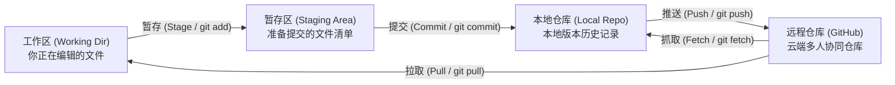
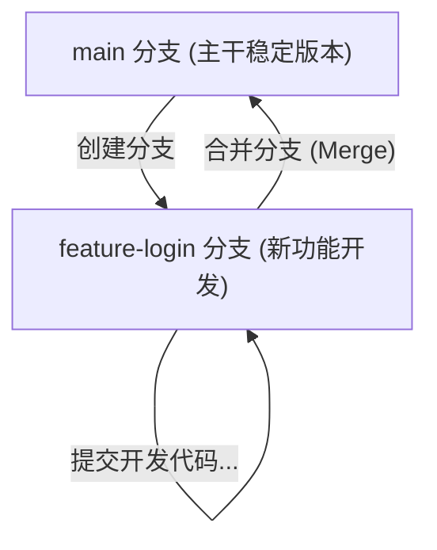
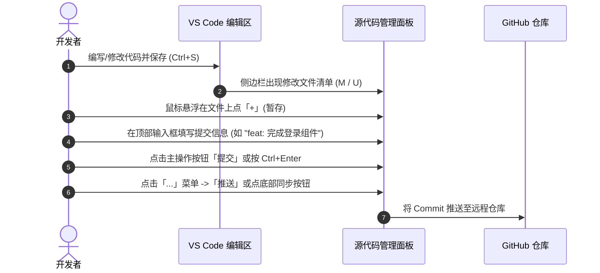

# VS Code Git / GitHub 操作菜单深度实操指南

> 本指南针对 VS Code「源代码管理」面板顶部的 **「...（更多操作）」** 菜单各项功能进行逐一拆解与实战演示，帮助你从基础日常提交到分支协同、版本发布全流程掌握图形化 Git 操作。

---

## 一、Git 四大核心区域与操作关系图

在理解菜单前，首先要清楚 Git 的 4 个核心区域：



- **工作区 (Working Directory)**：你在 VS Code 资源管理器里直接修改保存的文件。
- **暂存区 (Index / Stage)**：点了 `+` 号暂存的文件，准备放入下一个版本快照。
- **本地仓库 (Local Repository)**：存储在本地 `.git` 目录中已确认提交的历史版本。
- **远程仓库 (Remote / GitHub)**：托管在 GitHub 上的在线云端仓库。

---

## 二、菜单项全面功能解析

下面按你截图中的菜单顺序自上而下进行逐项详解：

```
[视图相关]
├─ 以树形式查看
└─ 查看和排序 >

[高频独立操作]
├─ 拉取
├─ 推送
├─ 克隆
├─ 签出到...
└─ 抓取

[分类子菜单]
├─ 提交 >
├─ 更改 >
├─ 拉取，推送 >
├─ 分支 >
├─ 远程 >
├─ 存储 >
└─ 标记 >

[诊断排查]
└─ 显示 GIT 输出
```

---

### 1. 视图与展示控制

#### 📁 以树形式查看 (View as Tree)
- **作用**：切换已修改文件的显示视图。
- **操作效果**：
  - **默认（列表视图）**：所有修改过的文件直接平铺显示，适合文件数量较少时快速点击。
  - **勾选后（树形视图）**：按文件夹层级折叠展开（例如 `src/components/Button.vue`），适合大型多目录项目，能清晰了解改动涉及哪些子模块。

#### 🔃 查看和排序 (View & Sort)
- **子项包括**：
  - **按名称排序** / **按路径排序** / **按状态排序**（新增 `U`、修改 `M`、删除 `D`）。
  - **紧凑文件夹 (Compact Folders)**：像 VS Code 文件树一样将单一层级子文件夹折叠合拢显示。

---

### 2. 常用一级独立操作（高频快捷项）

#### ⬇️ 拉取 (Pull)
- **对应 Git 命令**：`git pull`
- **作用**：从远程 GitHub 仓库下载最新的代码，并**直接自动合并**到你当前的本地工作分支。
- **使用场景**：每天开始写代码前，或者团队成员告诉你“远程代码已更新”时执行。
- **注意事项**：如果本地有未提交的改动且与远程改了同一行，会产生**冲突 (Conflict)**。建议拉取前先将本地改动提交或暂存 (Stash)。

#### ⬆️ 推送 (Push)
- **对应 Git 命令**：`git push`
- **作用**：把本地仓库里所有已完成的提交（Commit）上传到 GitHub 远程仓库。
- **使用场景**：本地完成了阶段性代码编写与 Commit，需要把成果同步到 GitHub 备份或供他人查看。
- **注意事项**：若远程已有其他人提交过的新内容，直接 Push 会被拒绝，必须**先拉取 (Pull) 再推送**。

#### 📥 克隆 (Clone)
- **对应 Git 命令**：`git clone <url>`
- **作用**：把 GitHub 上的在线仓库完整下载到本地电脑并作为项目打开。
- **操作步骤**：
  1. 点击「克隆」；
  2. 顶部输入框会提示：粘贴 GitHub 仓库地址（如 `https://github.com/user/repo.git`）或直接点击「从 GitHub 克隆（需登录账号）」；
  3. 选择本地要存放的文件夹，VS Code 会自动下载并询问是否打开该工作区。

#### 🔀 签出到... (Checkout to...)
- **对应 Git 命令**：`git checkout <branch>` 或 `git switch <branch>`
- **作用**：切换分支、切换标签或从某个分支创建新分支。
- **操作步骤**：
  1. 点击后顶部弹出搜索栏；
  2. 可以直接搜索并点击已有的本地/远程分支名进行切换；
  3. 也可以选择第一项 **「+ 创建新分支...」** 或 **「从...创建新分支」**。
- **提示**：VS Code 窗口最左下角的状态栏也会显示当前所在分支（如 `main`），点击该分支名同样能触发此功能。

#### 📡 抓取 (Fetch)
- **对应 Git 命令**：`git fetch`
- **作用**：向 GitHub 询问最新状态，并下载远程分支的提交索引到本地，**但不会修改你本地工作区的任何代码**。
- **与「拉取 (Pull)」的区别**：
  - `Fetch` 只获取情报，不碰你的文件，绝对安全；获取后 VS Code 底部状态栏会显示如 `↓2`，表示远程有 2 个新提交等待你拉取。
  - `Pull = Fetch + Merge`，不仅拿情报，还会强制把改动合并到你的代码中。

---

### 3. 分类子菜单深度剖析

#### 📦 提交 > (Commit >)

管理本地代码快照的生成：

| 菜单项 | 对应命令 | 功能说明与应用场景 |
| :--- | :--- | :--- |
| **提交 (Commit)** | `git commit` | 提交**已暂存**的文件；若未暂存任何文件，VS Code 会弹窗询问是否将所有更改一并提交。 |
| **全部提交 (Commit All)** | `git commit -a` | 跳过手动点 `+` 暂存，直接将所有受版本控制的已修改文件打包提交。 |
| **提交已暂存 (Commit Staged)** | `git commit` | 仅严格将暂存区（有 `+` 号暂存的文件）记录为新提交。 |
| **提交并推送 (Commit & Push)** | `commit` + `push` | 一键操作：完成本地提交的同时立即推送到 GitHub（个人项目极力推荐，省去第二步操作）。 |
| **提交并同步 (Commit & Sync)**| `pull` + `commit` + `push` | 先拉取远程最新更新，再提交当前修改，最后一起推送到远程。 |
| **修正 (Amend)** | `git commit --amend` | **后悔药功能**：将当前的最新修改追加合并到**上一次**的 Commit 中，或者修改上一次的提交备注信息，不会生成多余的历史节点。*(注意：仅适用于还未 Push 到远程的提交)* |

---

#### 📝 更改 > (Changes >)

批量处理工作区与暂存区文件的快捷工具：

- **全部暂存更改 (Stage All Changes)**：相当于 `git add .`。把所有修改过、新增的文件一次性加入暂存区（移入「暂存的更改」列表）。
- **全部取消暂存更改 (Unstage All Changes)**：相当于 `git restore --staged .`。把所有暂存区的文件退回到普通修改状态，代码内容不丢失。
- **放弃所有更改 (Discard All Changes)**：⚠️ **极度危险操作！**
  - 相当于 `git restore .`。
  - 会把所有未提交的修改**彻底撤销**，恢复到上一次 Commit 时的状态。一旦误点，未保存到 Git 的代码将**无法找回**！

---

#### 🔄 拉取，推送 > (Pull, Push >)

更高级的远程同步选项：

- **从...拉取 (Pull from...)**：手动指定从哪一个远程仓库（如 `origin` 或 `upstream`）的哪一个特定分支拉取。
- **推送到... (Push to...)**：手动指定推送到哪一个远程仓库或新建远程分支。
- **强制推送 (Push (Force))**：
  - 相当于 `git push --force`。
  - ⚠️ **强行用本地历史覆盖 GitHub 上的历史**。通常仅在执行了分支变基（Rebase）或回滚本地历史后使用。多人协作时千万慎用，否则会冲掉队友的代码！
- **同步 (Sync)**：
  - 相当于 `git pull --rebase/merge` 然后 `git push`。
  - VS Code 左下角状态栏两个旋转箭头的图形操作就是它，自动先拉再推。

---

#### 🌿 分支 > (Branch >)

Git 最核心的分支管理功能：



- **创建分支... (Create Branch...)**：基于当前所在分支的当前节点切出一个新分支。
- **从...创建分支... (Create Branch From...)**：指定基于某一个历史 Commit、Tag 或远程分支来创建新分支。
- **重命名分支... (Rename Branch...)**：更改当前分支的名称。
- **删除分支... (Delete Branch...)**：删除不需要的本地分支（不能删除当前正处在的分支，需先签出到其他分支）。
- **合并分支... (Merge Branch...)**：将其他分支的代码合并进当前所在的分支（例如先切到 `main`，再点击合并 `dev`，则 `dev` 的内容进入 `main`）。
- **变基分支... (Rebase Branch...)**：使用 Rebase 方式将当前分支基底移至目标分支最新提交上，保持提交历史呈单一直线，比 Merge 更清爽。
- **发布分支 (Publish Branch)**：如果你新建了一个本地分支（如 `feature-test`），GitHub 上还没有，点击它就会自动在 GitHub 创建同名远程分支并关联。

---

#### 🌐 远程 > (Remote >)

管理本地与 GitHub 的连接纽带：

- **添加远程... (Add Remote...)**：
  - 相当于 `git remote add <name> <url>`。
  - 如果你是在本地新建的项目（`git init`），点击此项输入 GitHub 仓库的 URL（例如 `https://github.com/xxx/yyy.git`），并命名为 `origin`，本地代码便与 GitHub 建立了连接。
- **拿取 (Fetch) 从所有远程**：同时抓取所有已配置远程源的最新状态。
- **移除远程... (Remove Remote...)**：解除与某个远程仓库的关联。

---

#### 📦 存储 > (Stash >) —— 「临时储藏室」

开发过程中极度实用的“临时存盘”功能：

> **典型痛点**：你正在写某个功能，代码写了一半还没法运行，突然领导让你紧急切换到 `main` 分支修一个线上 Bug。此时直接切分支会被 Git 阻止（提示未保存的改动会被覆盖），但你又不想生成一个垃圾 Commit。
> **解法**：使用 **Stash（存储）**！

- **存储 (Stash)**：相当于 `git stash`。将工作区所有已修改但未提交的内容临时“收纳隐藏”起来，工作区瞬间变干净，你可以随意切换分支。
- **存储 (包含未跟踪) (Stash Include Untracked)**：连同新创建的文件（未被 Git 追踪过的文件）一起打包存起来。
- **弹出存储... (Pop Stash)**：恢复之前存起来的内容，并且从存储列表中**删除**该条记录（相当于拿出来）。
- **应用存储... (Apply Stash)**：恢复存起来的内容，但**保留**存储列表中的记录（可以重复应用到多个分支）。
- **删除存储... (Drop Stash)**：丢弃选中的某一条存储记录。
- **清除所有存储 (Clear Stashes)**：清空所有暂存的历史快照。

---

#### 🏷️ 标记 > (Tag >)

版本里程碑（软件发版必备）：

- **创建标记... (Create Tag...)**：
  - 相当于 `git tag v1.0.0`。
  - 为当前提交打上一个永久性的静态版本标签（如 `v1.0.0`、`v2.1-beta`），常用于软件正式发布。
- **推送标记 (Push Tags)**：
  - ⚠️ **特别提示**：普通的 `Push` 是**不会**把本地 Tag 推送到 GitHub 的！
  - 必须点击「推送标记」或者命令行 `git push --tags`，GitHub 仓库的 Releases 页面才会出现对应的版本标签。
- **删除标记... (Delete Tag...)**：删除指定的本地 Tag。

---

### 4. 底部排查诊断

#### 🔍 显示 GIT 输出 (Show Git Output)
- **作用**：在 VS Code 底部面板打开「输出（Output）」栏，并切换到 `Git` 通道。
- **何时使用**：
  - 每次点击拉取/推送弹框报错，但提示语模糊时；
  - 遭遇 GitHub 网络超时、代理错误（如 `Failed to connect to github.com port 443`）；
  - 遭遇权限问题（如 `Permission denied (publickey)` 或 账号密码凭据失效）；
- **价值**：这里会忠实打印出 VS Code 后台替你执行的**每一条原始 Git 命令**及终端真实返回的日志，是定位解决 Git 疑难杂症的第 1 工具。

---

## 三、常用高频场景实战操作卡 (SOP)

### 场景 1：日常开发标准工作流（修改 ➔ 提交 ➔ 推送）



### 场景 2：新电脑/全新文件夹关联到 GitHub 仓库
1. 在 GitHub 上创建新仓库，复制仓库的 HTTPS 地址（如 `https://github.com/user/my-app.git`）；
2. 在 VS Code 打开你的本地代码文件夹；
3. 点击左侧源代码管理，点击 **「初始化仓库」**；
4. 点击「...」菜单 -> **「远程」** -> **「添加远程...」**；
5. 粘贴刚才复制的 URL，回车，给远程起名为 `origin`；
6. 在消息框输入初始化信息（如 `init repo`），点击 **「全部提交」**；
7. 点击「...」菜单 -> **「分支」** -> **「发布分支」**，代码即成功上传到 GitHub！

### 场景 3：紧急临时切换分支修 Bug（Stash 妙用）
1. 正在 `feature` 分支修改，未写完；
2. 点击「...」菜单 -> **「存储」** -> **「存储 (包含未跟踪)」**，起个名字叫 `temp-wip`；
3. 点击左下角分支名，切换到 `main` 分支修复紧急问题；
4. 修完后提交并推送 `main` 分支；
5. 切回 `feature` 分支；
6. 点击「...」菜单 -> **「存储」** -> **「弹出存储...」**，之前的未完成代码毫发无损恢复！

---

## 四、VS Code 源代码管理面板常用图标速查

除了 `...` 菜单，面板本身提供的快捷小图标也非常常用：

| 图标外观 | 含义 / 功能 | 说明 |
| :---: | :--- | :--- |
| **`+`** | 暂存更改 (Stage) | 将单文件或所有文件加入暂存区 |
| **`-`** | 取消暂存更改 (Unstage) | 从暂存区移回工作区普通修改 |
| **`↩` (弯箭头)** | 放弃更改 (Discard) | 撤销文件所有修改（危险操作） |
| **两个圆圈箭头** | 同步更改 (Sync) | 底部状态栏上，表示先拉取后推送 |
| **分叉图标** | 当前分支 (Branch) | 底部状态栏左下角，点击即可快速切换分支 |

---

*文档生成时间：2026-11-13*  
*适用工具：Visual Studio Code (含内置 Git 扩展及 GitHub 集成)*
